# 7 · The network: crew, jobs, portfolio, showcase

The people side of The Cavern — the part that makes it an ecosystem rather
than a private tool. Filmmakers find each other (crew directory), hire and
get hired (jobs, casting calls), and show the work (portfolio, credits,
showcase). Everything here is built from the work itself: credits come from
the projects people were actually on.

## Screens

| | Desktop | Phone |
|---|---|---|
| `/crew` | 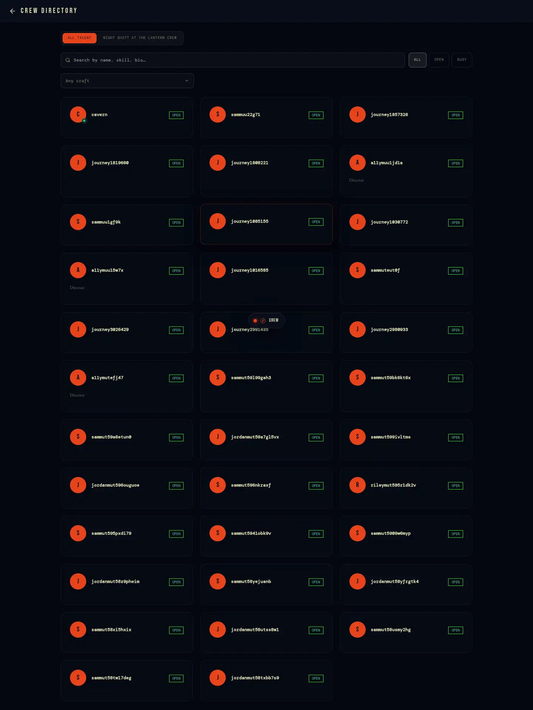 | 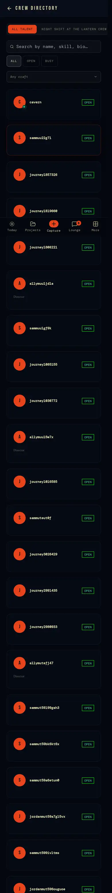 |
| `/crew/[id]` | 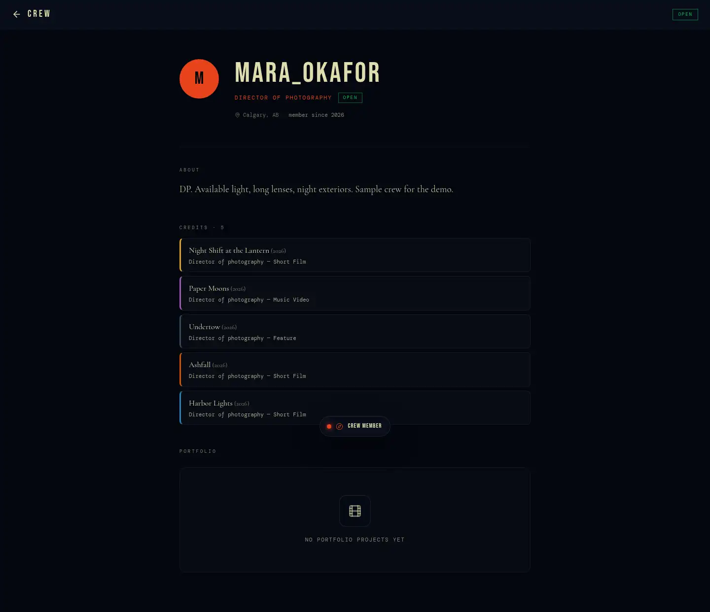 | 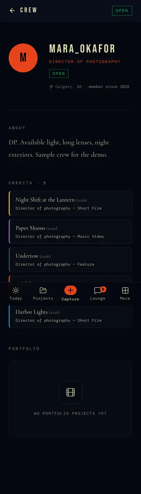 |
| `/jobs` | 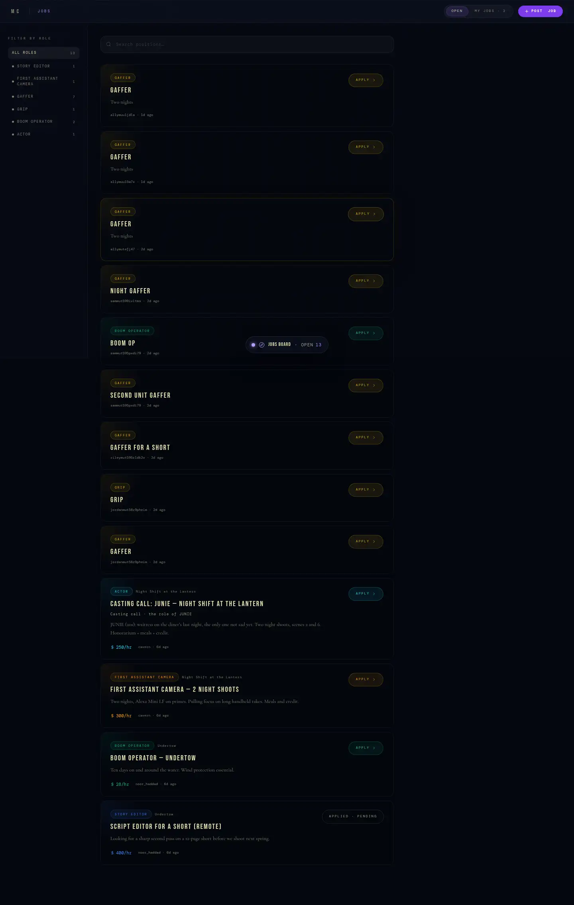 | 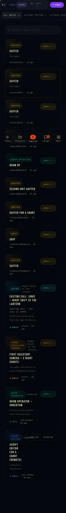 |
| `/jobs/[id]` | 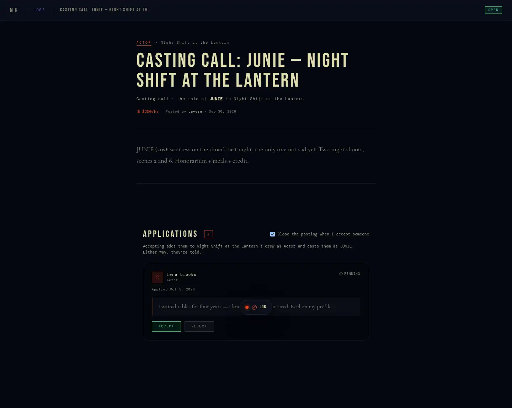 | 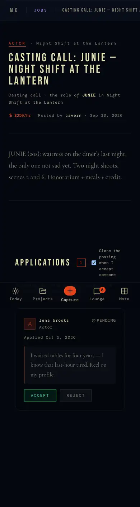 |
| `/portfolio` | 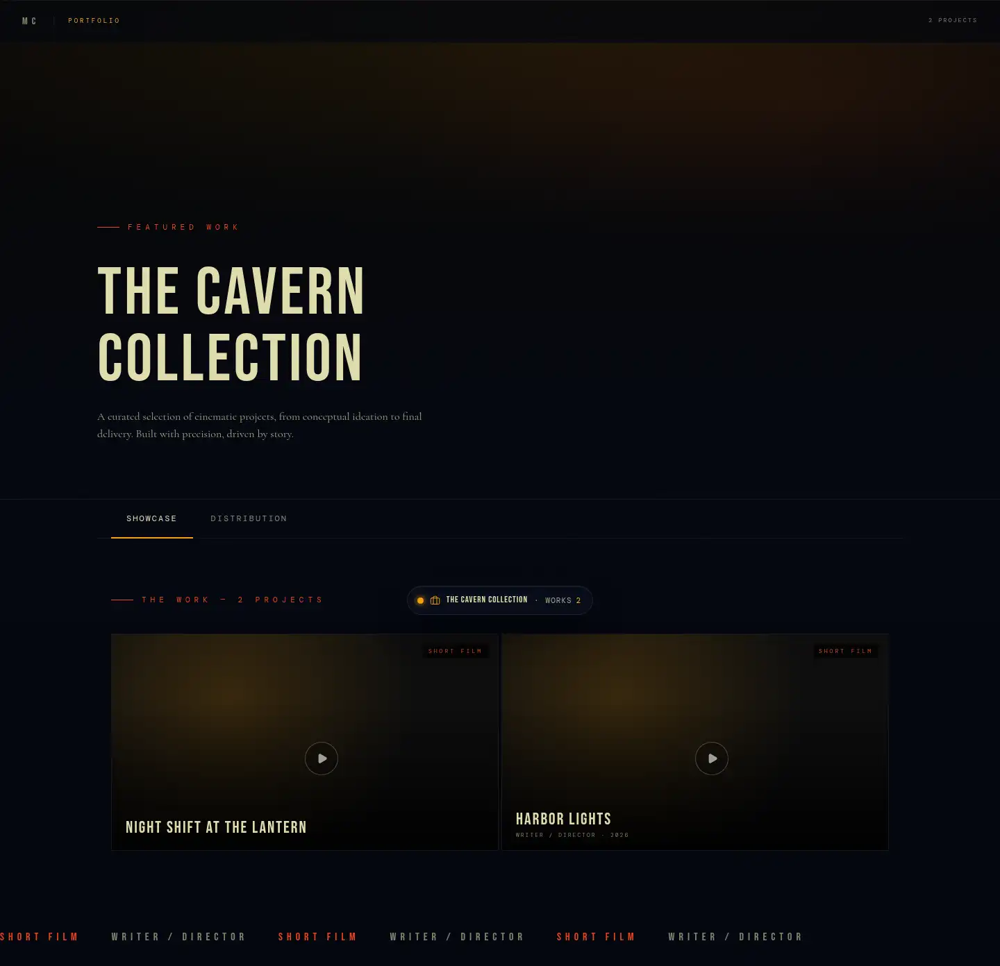 | 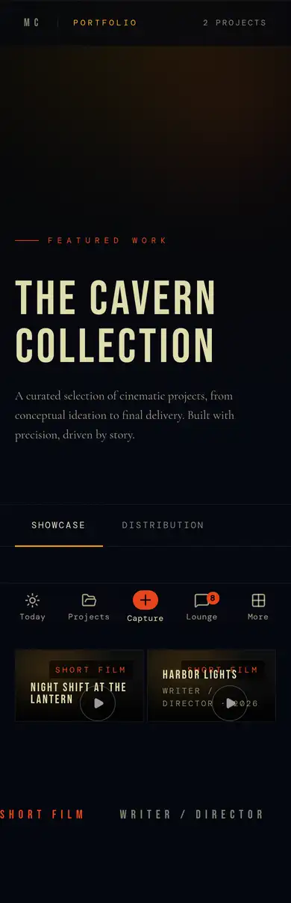 |
| `/portfolio/manage` | 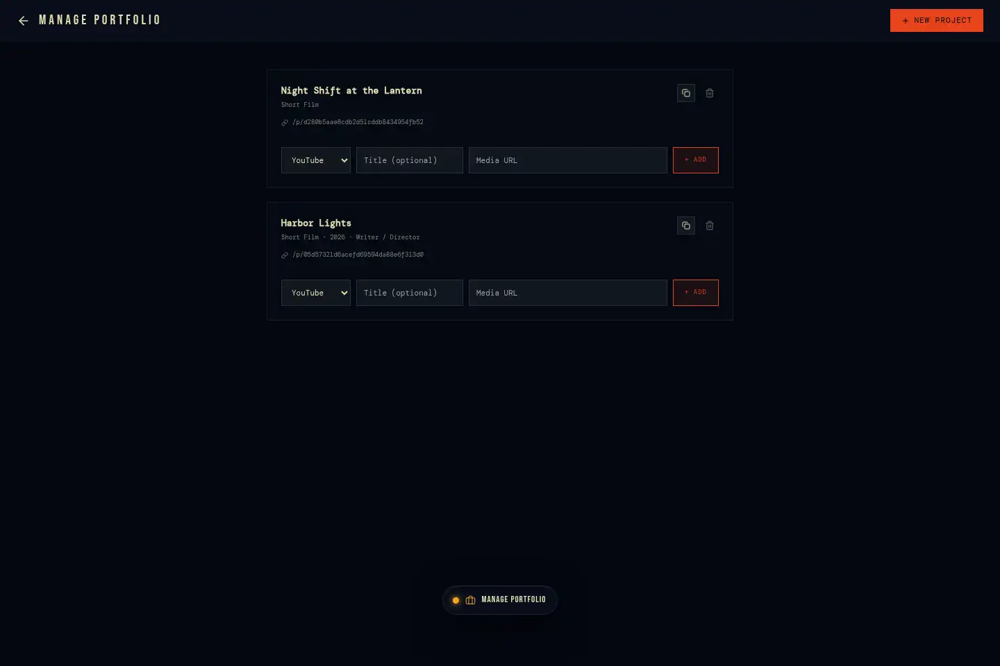 | 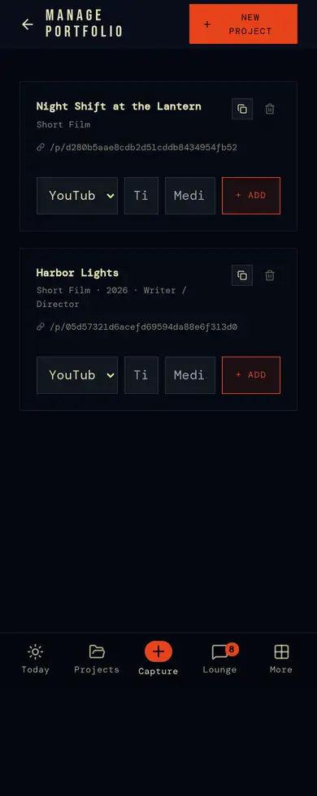 |
| `/showcase` (public) | 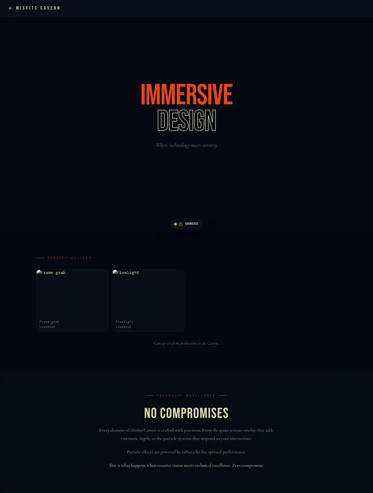 | 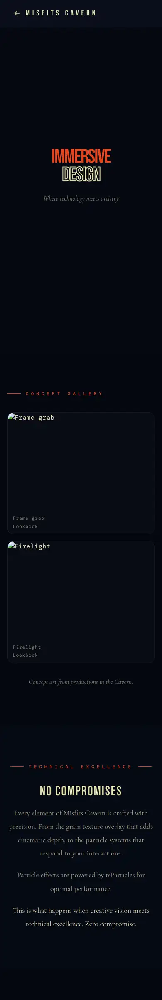 |

## Pages

### `/crew` — crew directory
Everyone who isn't sample data (`is_sample = false`): search by name, filter
by craft (`crafts`, `CraftPicker`), availability, "online now" (presence).
Cards open `/crew/[id]`. Empty / no-match states.

### `/crew/[id]` — a person
Profile (public columns only), craft, bio, location, links, **credits**
(`get_person_credits`: projects they created, crew rows with craft,
castings with the part — public projects for outsiders, the team's others for
teammates), portfolio pieces, message (→ Lounge DM), invite to a project.

### `/jobs` — jobs board
Open roles across the network: craft, project, pay, location, dates, brief.
Filter by craft; **Post a role** (the form opens pre-written when arriving
from casting or a project's brief — `rolePost`). A **casting call**
(`jobs.character_name`) says "accepting someone casts them in the role".
**Apply** from the card with an optional cover note. States: loading · error
("Couldn't load job listings") · none posted · none open · no match.

### `/jobs/[id]` — a role
The role, the project, the poster. For applicants: apply / applied. For the
poster: applicants with their profiles and notes; **respond**
(`respond_to_application`: accept → adds them to `project_crew` with the
job's craft, casts them for a casting call, optionally closes the job,
notifies them; decline). Transitions: pending → accepted or declined;
declined → accepted ("Mark accepted"); an acceptance is final (undo a hire
from the crew). The same answer twice is refused. Answers to one posting run
one at a time (the posting's row is locked), so with "Close the posting when
I accept someone" two acceptances at once fill it once — the second is
refused ("just filled") and the page reloads what the database holds. One
answer at a time on the page too: the buttons wait while one is saving.

### `/portfolio` — your work, presented
A cinematic page of the person's pieces (the work, a project bible per piece,
festival circuit, campaigns): embeds for YouTube / Vimeo / Drive, images,
links. **The header is the person** (name, role and location, bio, avatar and
"Open to work" from their profile, `lib/portfolio/header.ts`); a bare profile
says what to add. A piece can carry a **cover image** (`portfolio_projects.cover_url`,
an https link, checked by the database; shown on the cards here and on the
crew page). **Who can see a piece** is the owner's choice per piece (`lib/portfolio/visibility.ts`: Private, Link only, Public); a new piece is private, and the database, not the share link, enforces it. **A person's own page** (`/u/<username>`, public, signed out, `get_portfolio_page`): the person at the top and their **public** pieces as a grid of covers, each linking to its own `/p/<token>` page (which now shows the cover as its header and in the link preview), then **Credits**: the public films they are credited on (the creator, confirmed crew, cast: only what the work vouches for, never a pending invite), each linking to the film's own page (`/shared/<token>`, the project's public lookbook with its press-kit credits and laurels). It is **off until the owner publishes it** (`profiles.portfolio_page`: Off, Link only, Public; Link only is reachable by the name but told not to be indexed). Plan for the rest (project portfolio pages, curation, verified credits, the PDF one-sheet): `plans/2026-11-08-portfolio-upgrade.md`.

### `/portfolios` — the public directory
The people whose own page is **public** (`profiles.portfolio_page`), signed out, searched by name, craft or place (`list_public_portfolios`; 24 a page, `?q=` and `?page=`, `lib/portfolio/directory.ts`): a card each with their cover, name, craft and place, how many public pieces they have and "Open to work", linking to `/u/<username>`. **Link only is the opt-out**: such a page is reachable by name but never listed; an off page does not exist; sample accounts are never listed. The plain directory may be indexed, a search or a later page never is. **Reached from inside the suite** (2026-11-08): the command palette ("Browse Portfolios"), the owner's `/portfolio` (under the header: "Your public page →" once the page is on, else "Publish your page →", and "Browse portfolios →"; `PortfolioLinks`), a person's crew page ("PUBLIC PAGE →" when they have published one) and the foot of every `/u/<username>` page ("More portfolios →").

### `/portfolio/manage`
**Your page** (Off / Link only / Public, with the link to copy once it is on: `PagePublishSetting`) at the top. Add / remove pieces (title, format, year, role, description, a cover image link
with a preview, who can see it, media links), copy each piece's share link (`/p/<token>`). Projects finished in
the suite are added from their Delivery phase (milestone "Add it to your
portfolio").

### `/showcase` — public
The network's public face: published images and video from `public`,
non-sample projects (`get_public_showcase`, 24), signed out.

## Rules

- Sample (demo) people and projects never show on public surfaces or in the
  directory; jobs on sample projects are listed only to that production
  (`internal.job_listed`).
- Job posts linked to a project need `can_shape_project`; only the poster
  responds to applications; hiring never changes an existing member's role.
- Applicants can read jobs they applied to (`internal.applied_to`).
- One SELECT policy on `jobs` ("Jobs readable": the poster, listed open
  postings, an applicant's own) — `20261007010000_jobs_one_select_policy`.

## Connections

Brief → role posts. Casting board → casting calls. Accept → project crew →
call sheets, Lounge audiences, credits. Project delivery → portfolio → press
kit (`/p`) → showcase.

## Known gaps

- No reviews, references or verified credits yet (product call).
- Crew, jobs, portfolio and profile pages query tables directly rather than
  through `lib/` (BACKLOG 3.2).
